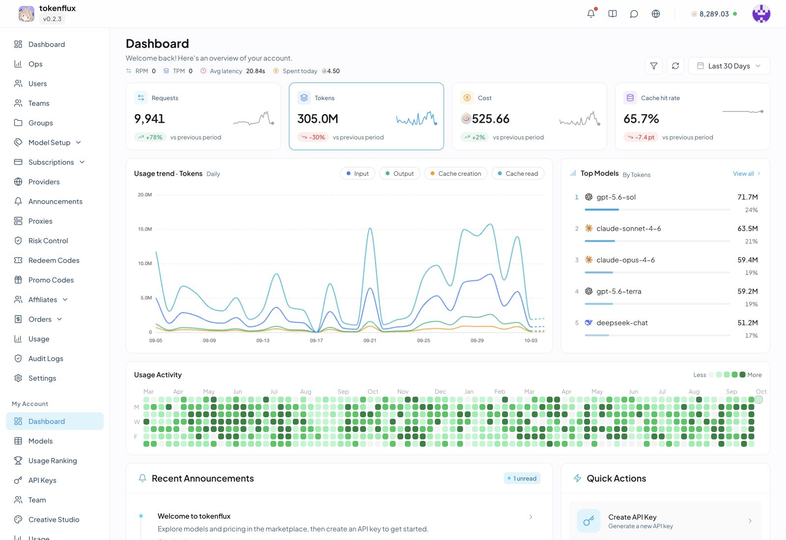
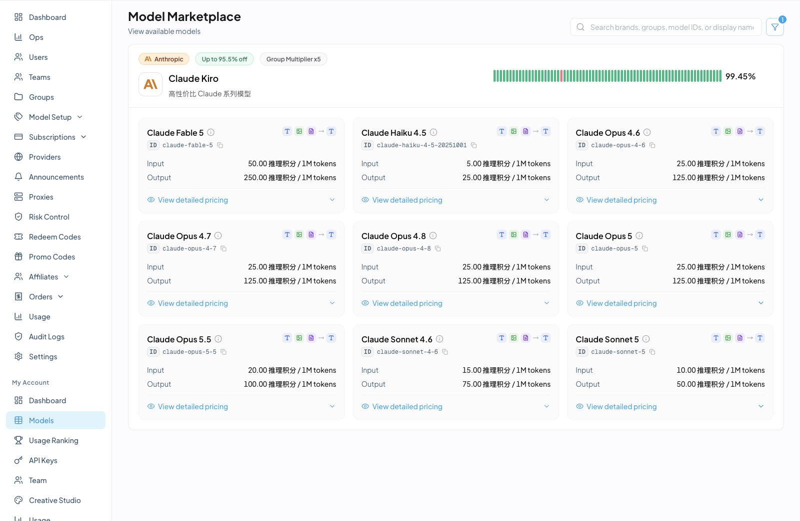
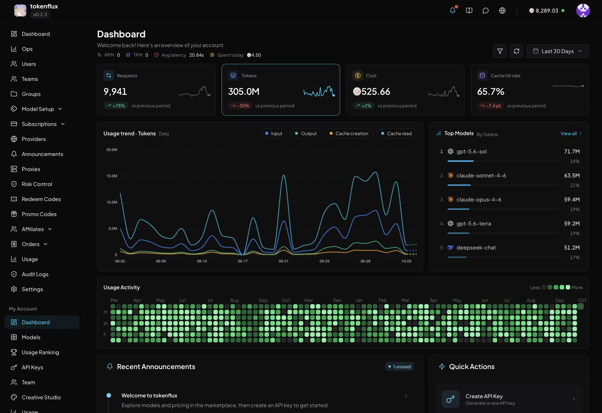
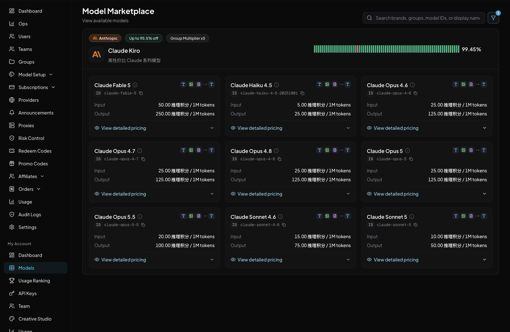

# Sub-TokenRouter-ahhil / SuperAHHil

这是 SuperAHHil 的部署源码，基于 [TokenFlux/TokenRouter](https://github.com/TokenFlux/TokenRouter) `v0.4.0`，上游提交为 `c8ee83a521495d5b4e20f5646978e51ad8a9aac1`。TokenRouter 的前身是 [Wei-Shaw/sub2api](https://github.com/Wei-Shaw/sub2api)。Git 历史保留从 `v0.3.0` 开始的定制提交和上游演进。

## SuperAHHil 定制功能

- 黑色首页、登录、注册和使用说明页面，由 Caddy 提供静态文件，控制台和 API 交给应用处理。
- “充值/订阅”页面的大字“购买兑换码”入口，购买地址和启用状态在管理员设置中配置。
- 站长私信：管理员向单个、多个或全部活跃普通用户发信，用户可回复，支持未读提醒、已读状态和表情。
- OpenAI 提供商的 Client Class：不限、Codex、non-Codex，覆盖提供商选择、重试和连接复用。分类依据请求头，伪造请求头可以绕过分类，访问授权仍由 API Key 等认证机制控制。

## 开发与部署入口

- [SuperAHHil 部署、品牌设置和升级](docs/guides/deployment/superahhil.md)
- [源码构建 Compose](deploy/superahhil/compose.yaml)、[环境变量样例](deploy/superahhil/.env.example)、[Caddy 示例](deploy/superahhil/Caddyfile.example)
- [黑色页面源码](deploy/superahhil/site/)
- [站长私信设计](docs/domains/site_messages.md)、[提供商策略](docs/domains/gateway_policy_controls.md)
- [开发工具链和测试](docs/operations/development_workflow.md)

生产密码、密钥、数据库、用户消息、日志和备份由部署环境单独保存。新环境需要创建管理员，并在后台设置站点名称和兑换码购买地址。定制版通过本仓库构建和更新，使用上游安装脚本、预编译镜像或在线更新会覆盖定制功能。

许可证见 [LICENSE](LICENSE)，上游标注为 LGPL-3.0-or-later。下文是 TokenRouter 的上游介绍，其中的发行版和镜像链接指向上游项目。

<div align="center">
  

  <h1>TokenRouter</h1>

  <p>An open source unified LLM gateway</p>

  <p>
    <a href="https://github.com/TokenFlux/TokenRouter/actions/workflows/ci.yml"></a>
    <a href="https://github.com/TokenFlux/TokenRouter/releases"></a>
    <a href="https://github.com/TokenFlux/TokenRouter/pkgs/container/tokenrouter"></a>
    <a href="LICENSE"></a>
  </p>

  <p><a href="README_ZH.md">简体中文</a> | <strong>English</strong></p>
  <p><a href="https://discord.com/invite/7XZzukhX4E">Join our Discord community</a></p>
</div>

## Overview

TokenRouter is an open source unified LLM gateway. It puts model services from Anthropic, OpenAI, Gemini, and other vendors behind one endpoint, so a client can call models from different vendors with a single API key.

> [!WARNING]
> Commercial API gateway services are permitted under the applicable open-source licenses. You must not impersonate the official TokenFlux service or use names, logos, domains, interfaces, or promotional materials that misleadingly suggest official operation, authorization, partnership, or endorsement by TokenFlux. Commercial operators are encouraged to customize the frontend and clearly identify the actual operator. The relevant rights holders reserve the right to seek corrective action under applicable law for infringement or such confusion. See the [Commercial Use and Branding Notice](BRANDING_EN.md).

## Screenshots

<details open>
<summary>Light mode</summary>

### Dashboard



### Model Marketplace



</details>

<details>
<summary>Dark mode</summary>

### Dashboard



### Model Marketplace



</details>

Visit the service officially operated by TokenFlux at [tokenflux.dev](https://tokenflux.dev).

## Capabilities

| Area | What you can do |
| --- | --- |
| Model access | Accept Anthropic Messages, OpenAI Responses, Chat Completions, and Gemini requests, and convert between the protocols a group allows |
| Upstream platforms | Connect Anthropic, OpenAI, Gemini, Antigravity, Grok, Qoder, Kimi, Zhipu, and DeepSeek through OAuth accounts, API keys, AWS Bedrock, or Vertex AI |
| Routing and retries | Pick an upstream by model, protocol support, rate limit state, and sticky sessions, and move to the next one when an upstream fails |
| Access control | Manage users, teams, groups, and API key quotas, concurrency, and RPM limits. Sign in with email and password, passkeys, two-factor authentication, GitHub, Google, LinuxDo, OIDC, WeChat, or DingTalk |
| Billing and payments | Charge by usage, with balance, subscription plans, quota packs, redeem codes, and referral rebates. Built-in payments support EasyPay, Alipay, WeChat Pay, Stripe, and Airwallex |
| Content moderation | Block requests with keyword and hash rules, and ban offending users automatically |
| Admin dashboard | Browse usage logs and statistics, set up alerts and email reports, and upgrade or roll back online. The creative studio generates and edits images in the browser. The UI is available in Simplified Chinese and English |

### Protocols and Endpoints

| Type | Common endpoints |
| --- | --- |
| Anthropic Messages | `POST /v1/messages` |
| OpenAI Responses / Chat | `POST /v1/responses`, `POST /v1/chat/completions` |
| Gemini | `POST /v1beta/models/{model}:generateContent`, `POST /v1beta/models/{model}:streamGenerateContent` |
| WebSocket | `GET /v1/responses`, `GET /v1/realtime` |
| Embeddings | `POST /v1/embeddings` |
| Images | `/v1/images/generations`, `/v1/images/edits`, `/v1/images/batches` |
| Video | `/v1/videos/generations`, `/v1/videos/edits`, `/v1/videos/extensions` |
| Voice | `/v1/tts`, `/v1/stt`, `/v1/custom-voices` |
| Search | `/v1/web_search`, `/v1/x_search`, `/v1/alpha/search` |
| Models and usage | `GET /v1/models`, `GET /v1/usage` |

The [upstream provider capability matrix (Chinese)](docs/interfaces/upstream_provider_matrix.md) lists which upstream platforms serve each endpoint.

## Quick Start

Deploy with Docker Compose:

```bash
mkdir -p tokenrouter-deploy && cd tokenrouter-deploy

# Download the Compose file and .env, and generate the database password and secrets
curl -sSL https://raw.githubusercontent.com/TokenFlux/TokenRouter/main/deploy/docker-deploy.sh | bash

docker compose up -d
```

Then open `http://localhost:8080`. You can set the admin password with `ADMIN_PASSWORD` in `.env`. If it is not set, TokenRouter generates a random password and prints it to the log:

```bash
docker compose logs tokenrouter | grep "admin password"
```

The [deployment guide (Chinese)](docs/guides/deployment/index.md) covers other options such as the install script and standalone containers.

## Development

The backend is written in Go and the frontend in Vue 3. To run the full stack from source:

```bash
docker compose -f deploy/docker-compose.dev.yml up --build
```

[Development workflow (Chinese)](docs/operations/development_workflow.md) lists the required toolchain versions, how to run the backend and frontend separately, and the test commands.

## Documentation

- [Usage and operations guides (Chinese)](docs/guides/index.md): deployment, payment setup, and external integrations.
- [Engineering documentation (Chinese)](docs/index.md): architecture, business rules, interfaces, and operational constraints. Start here before changing code.
- [Upgrade notes (Chinese)](docs/operations/upgrade_notes.md): changes to watch for in each release.

## License

This project is distributed under the [GNU Lesser General Public License v3.0 or later](LICENSE).

Copyright (c) 2026 Wesley Liddick & TokenFlux

## Star History

<a href="https://star-history.com/#TokenFlux/TokenRouter&Date">
  <picture>
    <source media="(prefers-color-scheme: dark)" srcset="https://api.star-history.com/svg?repos=TokenFlux/TokenRouter&type=Date&theme=dark" />
    
  </picture>
</a>
